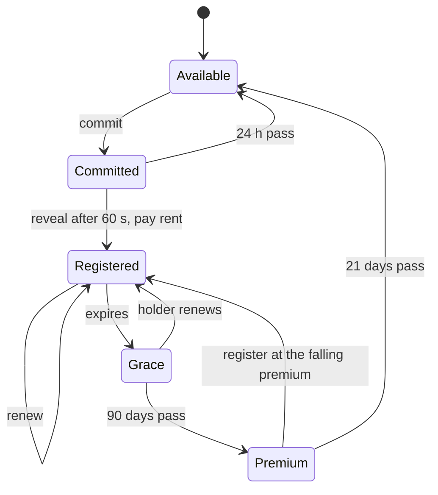
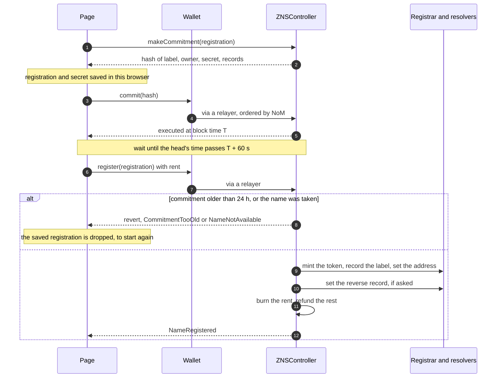

# zvm-zns guide

ZNS is ENS on the ZVM: `.znn` names that point at an address, and addresses
that name themselves back. The contracts are ENS's own, compiled from the
published `@ensdomains/ens-contracts` 1.7.0 sources. ZNS adds a registrar
subclass and a fork of the controller. The page is static: it reads the
contracts and their logs directly, so there is no server behind it. It was first
deployed at devnet.zenon.foo, and the same build publishes to GitHub Pages.

- `contracts/`: ZNS's three contracts (`src/`), ENS's sources
  (`vendor/ens-contracts/`), and the scripts that vendor, build, test and
  deploy them
- `web/`: the page (Vue, Vite, Tailwind, viem), in Karum's design system
- `deployments/zvm.json`: what is deployed where, written by the deploy;
  kept out of git, as every devnet deploys its own
- `secrets/zns.json`: the deploying key; git-ignored. It owns nothing after
  a deploy

## What is ENS's and what is not

| Contract | Source |
|---|---|
| `ENSRegistry`, `PublicResolver`, `ReverseRegistrar`, `UniversalResolver`, `GatewayProvider`, `StaticBulkRenewal`, `ExponentialPremiumPriceOracle` | ENS, unchanged |
| `ZNSRegistrar` | ENS's `BaseRegistrarImplementation`, with three additions (below) |
| `ZNSController` | a fork of ENS's `ETHRegistrarController`; each change is marked `ZNS:` |
| `ZNSPriceFeed` | new, 40 lines: the rate ENS's oracle converts with |

The registrar adds three things ENS gets from off-chain services:

1. **The label, in plain text.** ENS stores only `keccak256(label)` and reads
   names back from a subgraph. ZNS stores the label beside the token, so the
   token can name itself. Recording one is permissionless, and it checks
   itself: the label must hash to a token that exists.
2. **The card and metadata, on chain.** `tokenURI` is a `data:` URI with an SVG
   card: the name, coloured by length tier, and the expiry date. ERC-4906's
   `MetadataUpdate` fires whenever the expiry moves, so the node's NFT index,
   and so Karum, redraws it.
3. **A sale hands over control.** In ENS the token and the registry node are
   separate: a buyer has to `reclaim` before they can set a record, and until
   then the seller still can. Here every transfer also moves the registry
   node, as ENS's NameWrapper does for wrapped names. What the name points at
   is not touched; the page tells a new holder to point it at themselves.

The controller differs from ENS's in five ways:

- The TLD is `.znn`.
- **Labels are 3 to 63 characters of `a-z`, `0-9` and `-`,** checked by the
  contract. They cannot start or end with `-`, and `--` cannot be the third
  and fourth characters. ENS accepts any string and leaves normalisation to
  clients. That lets someone register a name no client can resolve, or a
  look-alike (a Cyrillic `а` in `аlice`). Everything this rule accepts is
  already in ENSIP-15's normal form. The cost is no emoji or non-Latin names.
- **Launch premium.** Names of up to six characters were priced at launch as
  if they had just left a grace period, so each went through ENS's falling
  premium instead of going to whoever's bot ran first. Six is the cut-off ENS
  used for its own 2019 short-name auction. Longer names opened at the base
  rent.
- **Rent is burned as it is paid**, to `0x000000000000000000000000000000000000dEaD`.
  That is the ZVM's burn address: the fee split already burns relayed tips
  there (zvm-docs `spec/SPEC.md`). The controller never holds a balance, and
  there is nothing for an owner to withdraw.
- ENS's second reverse record (`default.reverse`, for one name across many
  chains) is left out: a `.znn` name lives on one chain.

## The terms

Prices are ENS's shape at devnet scale, and read from the contracts, never
from the page:

| Length | Rent a year | ENS's |
|---|---:|---:|
| 3 characters | 128 ZNN | $640 |
| 4 characters | 32 ZNN | $160 |
| 5 or more | 1 ZNN | $5 |

- At least 28 days at a time. Anyone may renew any name.
- An expired name stops resolving to an owner. For **90 days** only its holder
  can renew it; then anyone can register it at a **premium** that halves
  every day and is gone after 21 days. It starts at **5,000 ZNN on devnet**
  (chain 7340469) and **100,000 on testnet and mainnet**
  (`NETWORKS` in `contracts/scripts/lib.mjs`). The deployment record carries
  the value as `terms`, because ENS's oracle keeps it in a private immutable.
- The price is ENS's `ExponentialPremiumPriceOracle` reading `ZNSPriceFeed`.
  The oracle expects a Chainlink USD feed, and the ZVM has none, so the feed
  is a constant set by its owner. Its answer, 1e8, makes the oracle's unit one
  ZNN wei. Moving the answer rescales every tier and the premium together:
  the page's owner tools show it as a multiplier. Changing the *ratio* between
  tiers needs a new oracle and controller, because both hold it as an
  immutable.

A name's life, in the order the contracts enforce:



## Registering



The commitment hides the name until the reveal. Without it, the relayer that
carries a registration could register the name first. Because the page saves
the registration and its secret before the commit is sent (step 3), a closed
tab resumes at the wait instead of paying for a second commitment. The wait is
by block time, since the controller judges it by `block.timestamp`.

## Names in other apps

The `UniversalResolver` is ENS's, so viem finds names with no ZNS code at all:
give the chain `contracts.ensUniversalResolver` and `getEnsName`,
`getEnsAddress` and `getEnsText` work (`contracts/scripts/test.mjs` checks all
three). A primary name counts only while the name also points back at the
address, so nobody can claim someone else's.

On **Karum** a name is an ordinary ERC-721: the node indexes it from its
Transfer events, and its card and traits (length, characters, expiry) come
from `tokenURI`. The page's "Sell on Karum" opens Karum's item page with
`?list=1`, which opens the listing form for the holder.

## Running it

```sh
cd contracts && npm install
npm run vendor     # ENS's sources, from the npm tarball, into vendor/
npm run build      # out/*.json, out/input.json, and web/src/abi.ts
npm run test       # 17 checks on a local anvil (the command is in the file's header)
npm run keys       # secrets/zns69.json; refuses to overwrite
npm run deploy     # funds the deployer from dev key 900, deploys, wires,
                   # hands every role to the owner, verifies on the explorer
```

`deploy` resumes: each step reads the chain first. The owner holds the
registry's root, the registrar, the reverse registrar, the price feed and the
controller. `-owner` defaults to the devnet admin,
`0xD73f244650c92b2263719BfFd921De6FE991900D`: the first EVM account of
go-zenon's devnet mnemonic, whose key is public. Pass `-owner` for a
deployment that is meant to be owned; the first deployment's is `0xE5Ef…8E9b`.

```sh
cd web && npm install
npm run dev        # http://localhost:47800/
npm run build && npm run preview   # the static build on :47801
npm run verify     # the live check, below
```

`npm run verify` drives the built page in headless Chrome with a stand-in
wallet that dev key 900 funds, and registers for real on chain 69:

- searches for a name and registers it through the page (commit, the
  minute's wait, reveal) as the wallet's primary name, while a second key
  registers another name for the same wallet from outside the page;
- checks that the card the page draws matches the contract's byte for byte;
- edits records, makes a subname, renews;
- switches the primary name from My names, renews both names in one
  transaction, and sends one away;
- checks that the rent reached the burn address and that nothing scrolls
  sideways at 400 px.

It spends about 3 ZNN a run.

The page reads the node `VITE_ZVM_NODE` names at build time unless told
otherwise (`?rpc=` or the node menu); no node is built in, and the build stops
without it or `VITE_GATEWAY` (`.env.example` has a local zvm-devnet's). Its build
is relative with hash routes (`#/name/alice.znn`), so it serves unchanged from
Pages, a domain's root, or a gateway's `/zns/`.
`.github/workflows/pages.yml` publishes `web/dist` on every push to `main`, built
with the organisation's `ZVM_NODE` and `ZVM_GATEWAY` Actions variables.
